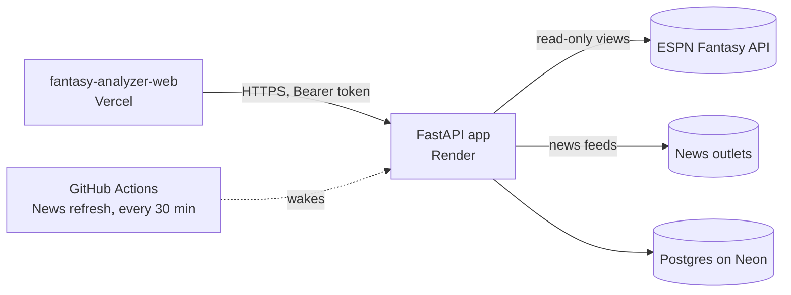

<div align="center">

# Fantasy Analyzer · API

**The engine behind Fantasy Analyzer: trades, pickups and playoff odds for ESPN fantasy basketball.**

[](https://github.com/MCantuncer/fantasy-analyzer-api/actions/workflows/ci.yml)
[](https://github.com/MCantuncer/fantasy-analyzer-api/actions/workflows/news.yml)
[](https://fantasy-analyzer-web.vercel.app)
[](https://fantasy-analyzer-api.onrender.com/api/health)

[](https://www.python.org)
[](https://fastapi.tiangolo.com)
[](https://docs.pydantic.dev)
[](https://numpy.org)
[](https://neon.tech)
[](https://docs.astral.sh/uv/)
[](https://github.com/astral-sh/ruff)
[](https://docs.pytest.org)

[Live app](https://fantasy-analyzer-web.vercel.app) · [Web client](https://github.com/MCantuncer/fantasy-analyzer-web) · [Report a bug](https://github.com/MCantuncer/fantasy-analyzer-api/issues)

</div>

---

## Contents

- [Overview](#overview)
- [Features](#features)
- [Architecture](#architecture)
- [Getting started](#getting-started)
- [Configuration](#configuration)
- [API reference](#api-reference)
- [How it works](#how-it-works)
- [Testing and validation](#testing-and-validation)
- [Deployment](#deployment)

## Overview

A FastAPI backend for ESPN **9-category head-to-head** fantasy basketball. Give it a league ID and team ID and it returns moves ranked by how much they change your playoff odds: trades the other owner should accept, free-agent pickups with the right drop, your category outlook, every team's build, and a full season simulation.

The web client lives in [fantasy-analyzer-web](https://github.com/MCantuncer/fantasy-analyzer-web) and runs at **https://fantasy-analyzer-web.vercel.app**.

## Features

| | Feature | Endpoint |
| --- | --- | --- |
| 🔁 | **Trade finder:** 1-for-1, 2-for-1 and 1-for-2 deals that help both builds and look fair to the other owner | `/api/analyze` |
| 🎯 | **Trade for one player:** fit, his owner's needs and the best three offers | `/api/target` |
| 🛒 | **Pickups:** every healthy free agent against every possible drop | `/api/analyze` |
| 🎲 | **Season simulation:** 4,000 runs of the remaining schedule in the league's real format | `/api/analyze` |
| ⭐ | **Trade of the day:** one league-wide win-win deal a day, with a poll | `/api/trade-of-the-day` |
| 🏀 | **Live scores:** NBA scores and box scores tagged with fantasy teams | `/api/scores` |
| 📰 | **Checked NBA news:** stories confirmed across sources before they show | `/api/news` |
| 🩹 | **Injury impact:** which teammates gain while a player is out | `/api/injury-impact` |
| 🧊 | **Injury risk:** players who miss games year after year are valued for fewer games, checked on past seasons | `/api/analyze` |
| 💬 | **Moves feed and league chat:** transactions, posts, replies and reactions | `/api/feed`, `/api/posts` |
| 🔐 | **Accounts and verified managers:** email or Google sign-in, team ownership proven through ESPN | `/api/auth/*`, `/api/team-link/*` |

## Architecture



```text
app/
├── main.py        FastAPI routes, caching and CORS
├── schemas.py     Pydantic request and response models (source of openapi.json)
├── espn/          ESPN client and parsing into projections and rosters
├── analysis/      Weekly model, trade finder, perceived value, simulation, injury impact
├── news/          News sources, extraction, verification against ESPN facts
├── backtest/      Week-by-week replays of finished seasons
├── accounts.py    Sign-up, sessions and team verification
├── feed.py        Moves feed from ESPN transactions
├── social.py      Posts, replies and reactions
├── scores.py      NBA scores and box scores
└── store.py       Postgres persistence, with an in-memory fallback
scripts/           Backtests, OpenAPI export, fixture recording
tests/             pytest suite against a recorded league, no network
```

## Getting started

**Prerequisites:** Python 3.12 and [uv](https://docs.astral.sh/uv/).

```sh
uv sync
uv run uvicorn app.main:app --reload --port 8000
```

Then open http://localhost:8000/docs for the interactive API docs, or start the [web client](https://github.com/MCantuncer/fantasy-analyzer-web#getting-started).

| Command | What it does |
| --- | --- |
| `uv run pytest` | Run the tests (a recorded league, no network) |
| `uv run ruff check .` | Lint |
| `uv run ruff format --check .` | Check formatting |
| `uv run python -m scripts.export_openapi openapi.json` | Regenerate the OpenAPI schema |

## Configuration

All settings are optional for local development.

| Variable | Default | Purpose |
| --- | --- | --- |
| `CORS_ORIGINS` | `http://localhost:5173` | Comma-separated web origins allowed to call the API |
| `DATABASE_URL` | none (in memory) | Postgres connection string for accounts, chat, the trade of the day, finished NBA days and news |
| `SECRET_KEY` | random per start | Signs team verification challenges; set it so they survive a restart |
| `GOOGLE_CLIENT_ID` | none | Google OAuth web client ID; Google sign-in stays off until it is set |
| `LEAGUE_CACHE_SECONDS` | `600` | How long league data from ESPN is cached |
| `DAILY_TRADE_WAIT_SECONDS` | `20` | How long a trade-of-the-day request waits before answering `pending` |
| `DAILY_TRADE_RECHECK_SECONDS` | `10800` | How often the day's pick is checked again |

## API reference

| Method | Path | Body | Returns |
| --- | --- | --- | --- |
| GET | `/api/auth/config` | | `{google_client_id}`, null while Google sign-in is off |
| POST | `/api/auth/signup` | `{email, password}` | `{token, me}` for a new account |
| POST | `/api/auth/login` | `{email, password}` | `{token, me}` |
| POST | `/api/auth/google` | `{credential}` | `{token, me}` from a Google Identity Services ID token |
| POST | `/api/auth/logout` | | Ends the session |
| POST | `/api/me` | | The account, its leagues (with the verified team, if any) and notices |
| POST | `/api/me/notices/clear` | | Clears the notices |
| POST | `/api/my-leagues/add` | `{league_id, season?}` | Follows a league (no team yet) |
| POST | `/api/my-leagues/remove` | `{league_id, season?}` | Unfollows it |
| POST | `/api/league-overview` | `{league_id, season?}` | League-only view: this week's matchups, the MVP candidate, league pulse, which teams have a manager |
| POST | `/api/league` | `{league_id, season?}` | League name, categories and teams |
| POST | `/api/analyze` | `{league_id, team_id, season?, keep_player_ids?}` | Full analysis report, only for the team you verified |
| POST | `/api/trade-of-the-day` | `{league_id, season?}` | Today's best win-win trade between any two teams, with poll votes |
| POST | `/api/trade-of-the-day/vote` | `{league_id, season?, date, team_id, take, voter}` | Records a "Would you take it?" vote and returns the updated pick |
| POST | `/api/team-link/start` | `{league_id, season?, team_id}` | A code to set as the team's ESPN abbreviation, and a signed challenge |
| POST | `/api/team-link/verify` | `{challenge}` | Checks the abbreviation on ESPN and makes the account that team's manager |
| POST | `/api/feed` | `{league_id, season?, page?}` | A week of moves (claims, losing bids, adds, drops, trades); for a verified manager also the chat, reactions and reply counts |
| POST | `/api/feed/replies` | `{league_id, season?, target}` | Replies on a move or a post |
| POST | `/api/posts` | `{league_id, season?, body, target?}` | Posts to the chat, or replies when `target` is set |
| POST | `/api/posts/delete` | `{league_id, season?, post_id}` | Deletes your own post |
| POST | `/api/reactions` | `{league_id, season?, target, reaction, on?}` | Toggles `steal`, `smart`, `overpay`, `lol`, or a `won:<team id>` trade vote |
| POST | `/api/target` | `{league_id, team_id, player_id, season?, keep_player_ids?}` | One player's fit, his owner's needs, and the best offer for him |
| POST | `/api/scores` | `{league_id, season?, day?, team_id?}` | A day of NBA games: scores, status and box scores, each player tagged with his fantasy team in this league; plus this week's upcoming games, naming `team_id`'s players in each |
| POST | `/api/injury-impact` | `{player_id, league_id?, season?}` | Teammates who gain while a player is out, from games his team played without him, each tagged with his fantasy team in `league_id` |
| POST | `/api/news` | `{league_id?, season?, include_held?}` | Checked NBA news from every source, each player tagged with his fantasy team in `league_id`; source health; today's most-added players |
| GET | `/api/news/refresh` | | Starts a check of every news source if the last is over 15 minutes old. For the scheduled ping |
| GET | `/api/health` | | `{ok: true}` |

Every endpoint except `/api/health`, `/api/news/refresh` and `/api/auth/*` needs `Authorization: Bearer <token>` from sign-up or sign-in. `season` defaults to the current ESPN season (2026-27 is `2027`). `keep_player_ids` are never offered in trades or suggested as drops.

The full schema is in [`openapi.json`](openapi.json), and served live at `/docs`. Regenerate it after changing `app/schemas.py`:

```sh
uv run python -m scripts.export_openapi openapi.json
```

## How it works

### The analysis model

- **Projections:** ESPN's season projections, blended with this season's per-game stats as games are played (`app/espn/parse.py`).
- **Weekly model:** each team starts its top healthy players (by z-score value) for about 3.4 games a week. Each category's weekly total is a normal distribution; counting stats use an over-dispersed Poisson variance, percentages use binomial variance on attempts (`app/analysis/model.py`).
- **Trades:** every 1-for-1, 2-for-1 and 1-for-2 with every team (`app/analysis/trades.py`). A deal is kept only if it
    - helps your categories,
    - helps theirs too, under their own build, and
    - gives them at least 85% of the value they send as owners see it: ESPN's rankings and auction values, this league's draft prices, and this season's rank as games are played (`app/analysis/perceived.py`).

  Each deal gets rough acceptance odds and a one-line pitch on why it helps them. Deals are ranked by playoff-odds gain weighted by those odds.
- **Trade of the day:** every pair of teams, scanned with the same finder from both sides (`app/analysis/daily.py`). A deal qualifies only if both owners see fair value and both teams gain in the categories they compete in; the top few must also keep both teams' playoff odds from dropping in the simulation. Deals are ranked by the smaller of the two gains, weighted by the chance both owners say yes. Teams take turns in the spotlight (one a day, fixed order per league), and the spotlight team's best deal wins when it's close to the overall best, so the pick moves around the league. Only fully healthy players change hands (no day-to-day, out or IR). A new pick is made each UTC day and re-checked every `DAILY_TRADE_RECHECK_SECONDS` (3 hours): it stays while it still qualifies and scores at least 85% of the best deal, and is replaced otherwise. Poll votes belong to the deal they were cast on. The scan takes a few seconds (longer on the free plan), so the endpoint answers `status: "pending"` after `DAILY_TRADE_WAIT_SECONDS` (default 20) and the client asks again.
- **Trading for one player:** pick any rostered player and get his fit with your build (category changes and playoff odds if you added him), his owner's build, needs and which of your players help them, and up to three offers (`app/analysis/target.py`). Offers use the trade finder's rules, except any gain for you counts and the owner's build only has to stay about even. Packages are one or two of your players for him, or two or three for him plus one of their low-value players. The best offer maximises playoff gain weighted by acceptance; fallbacks are the likeliest to be accepted and the cheapest on paper. If nothing keeps the owner's build even, the best long shots are shown with a note.
- **Pickups:** every healthy free agent against every possible drop, keeping the best drop.
- **Season:** 4,000 simulations of the remaining schedule with the league's real format: each category counts in "H2H each category" leagues, one result per matchup in "most categories" leagues (`app/analysis/sim.py`). Categories are drawn together, since counting stats rise and fall with games played, and each team carries a lasting shock for the whole simulated season, which stands in for injuries, trades and role changes.

Only ESPN head-to-head category leagues are supported for now.

### Accounts and verified managers

People sign up with an email and password (scrypt-hashed) or with Google, then add leagues by ID. Following a league shows only league-wide data (`/api/league-overview`, the moves feed). Anything about one team, like the analysis, the chat and reactions, needs the account to be that team's verified manager.

ESPN has no login for other sites, so a manager proves a team is theirs by changing its abbreviation on ESPN to a 4-character code from `/api/team-link/start` and calling `/api/team-link/verify`. Only the team's owner and the league manager can edit it, and the API reads it back from ESPN's league data. The code rides in an HMAC-signed challenge bound to the account that asked, which expires after 30 minutes, so nothing is stored until the check passes.

Each team has one manager and each account manages one team per league. The newest successful check wins: if another account verified the team before, it loses the team and gets a notice. This also recovers a team after a lost password. Sessions are random tokens kept for 90 days; only their SHA-256 hash is stored. No ESPN password or cookie is kept.

Set `SECRET_KEY` (any long random string) so challenges survive a restart, and `GOOGLE_CLIENT_ID` (a Google OAuth web client ID) to turn on Google sign-in. Accounts, posts and reactions use `DATABASE_URL` like the trade of the day, and live in memory without it.

The feed pages through the season a week (seven scoring periods) at a time. Transactions come from ESPN's `mTransactions2` view, one call per day: past days are cached for six hours, today for a minute.

### Private leagues

ESPN has no API keys for fantasy, so private leagues need the user's `espn_s2` and `SWID` cookies. Send them in the `X-ESPN-S2` and `X-ESPN-SWID` headers. The backend:

- uses them only for that request's read-only calls to ESPN,
- never logs, stores or returns them (tests check this),
- caches private-league data under a hash of the cookies, so one user's league is never served to someone else.

ESPN answers `401` for a private league without cookies, and the API passes that on as `401 {"detail": {"code": "private_league"}}`.

### NBA scores

ESPN's fantasy API has no scoreboard, but for any day it returns every player's line for each game. `/api/scores` adds those up into team scores and box scores, and takes start times from the NBA calendar. There is no quarter or clock, so a game counts as live from tip-off until ESPN marks its stats official or three hours pass.

A day is the same in every league. While a game is on, the day is fetched at most once a minute for everyone. Once a day's games are over (five hours after the last tip-off), it is saved to `DATABASE_URL` (table `nba_days`) and never fetched again. Other features can read finished games from there instead of calling ESPN.

### NBA news

`/api/news` gathers NBA news from several sources (`app/news/sources.py`) and checks it before it shows:

- **Facts:** ESPN's player data. Every check compares each player's injury status and NBA team with the last check; a change (a new injury, a return, a trade, a signing, a release) is a fact.
- **Outlets:** ESPN, RotoWire, CBS Sports, Yahoo Sports, RealGM, HoopsHype and The Stein Line. Outlets owned by the same company count once.
- **Tips:** Reddit r/nba. Never enough on its own.

Each item is tagged with the players its headline names in full (ESPN's own athlete tags for ESPN articles), never from a last name alone. Only NBA news becomes a story (`newsworthy` in `app/news/extract.py`): a move, an injury or return, a role change, or league business such as a suspension. Game guides, betting, previews, recaps, rankings, opinion, other leagues and a feed repeating its own title are dropped. On 155 hand-labelled headlines from four outlets (`tests/data/news_sample.json`) the filter keeps every news item and 91% of what it keeps is news. The kind (injury, return, trade, rumor, signing, release, role) and an injury's severity come from keyword rules. Items about the same player and kind of news within 48 hours become one story:

| Status | When |
| --- | --- |
| `confirmed` | ESPN's data agrees (the injury status, a team change), or outlets from two groups report it |
| `reported` | One outlet group |
| `held` | Only tips; hidden unless `include_held` |
| `didnt_happen` | Reported as a done trade, but the player's team has not changed after 72 hours |

When sources disagree on how bad an injury is (for example ESPN lists day-to-day and an outlet reports a fracture), the story's `conflict` says so, naming each source, and `severity` is the worst one. Headlines and summaries are always the sources' own; a story with only ESPN data gets a plain line from that data ("ESPN lists X as out").

A check runs at most every 15 minutes, started by any request when due. Items are stored in `news_items` (kept 14 days), and the last player snapshot, source health and trending players in `news_state`. On the free Render plan the server sleeps, so the `News refresh` GitHub workflow calls `/api/news/refresh` every 30 minutes; set the repository variable `API_URL` (e.g. `https://fantasy-analyzer-api.onrender.com`) to turn it on.

### Who gains from an injury

`/api/injury-impact` (`app/analysis/injury.py`) compares each teammate's minutes and per-minute stats in games the team played without the injured player against games he played, this season and last. ESPN gives every game line of a team's current players in one call per team and season (`filterStatsForSplitTypeIds` 5).

Checks before a number is trusted:

- **Sample size.** The measured minutes change is pulled toward a prior until there are `MINUTES_K` games of evidence. The prior shares his minutes among teammates by position and room to grow, so it is a fallback, not the answer.
- **Recency.** This season's games count half as much every `HALF_LIFE` team games back; last season counts `LAST_SEASON_WEIGHT`.
- **Per-minute rates** are pulled toward the player's normal rates (`RATE_K` minutes), and those toward an average rotation player's (`BASE_RATE_K`), so garbage-time minutes don't project as a breakout.
- **Other absences.** If another regular also missed most of those games, the result names him: part of the gain may be his.
- **Confidence** is `strong` (8+ games without him and a change clear of its 80% error band), `some` (3+ games) or `estimate` (mostly the prior).

The endpoint lists teammates whose 9-category value goes up and who would play 15+ minutes.

`scripts/injury_backtest.py` replays real absences (a regular out 3+ games in a row, then back) using only games before each one. Tuned on 2024-25, checked on 2025-26 (202 absences):

| | Minutes error per game | Top pick among the 2 biggest minutes gainers |
| --- | --- | --- |
| No change | 4.23 | |
| "His backup gets his minutes" | 4.71 | 23% |
| This model | 3.85 | 35% |

Chance is about 20%. Even knowing the real minutes, the best value pick would be right about 41% of the time, because stats over a few games are noisy; the model's value pick was right 27% (backup rule 24%).

## Testing and validation

CI runs Ruff (lint and format) and the pytest suite on every pull request and push to `main`.

### Test fixture

`tests/fixtures/chill_primera_2027.json.gz` is a trimmed copy of a public league. Re-record it with:

```sh
uv run python -m scripts.record_fixture 744636428 2027 tests/fixtures/chill_primera_2027.json.gz
```

### Season backtest

Replays finished seasons of a public league week by week through the live model, using only what was known on each week's first day (rosters, lineups and box scores before that day), and scores the weekly category odds and the playoff odds against what happened (`app/backtest/`):

```sh
uv run python -m scripts.backtest 744636428 2025 2026
```

The first run of a season downloads it from ESPN into `.cache/backtest/` (a couple of minutes); later runs read the cache. Lower Brier and log loss are better; a spread of 1.0 means the model is exactly as unsure as it should be, above 1 it is overconfident. Keep a model change only if it helps every season.

Add `--flat-durability` to replay without injury risk (every player equally durable), to compare.

### Injury-risk backtest

Checks the expected-games model (`app/analysis/durability.py`) on past seasons: fitted on 2023-24, tested on 2024-25 and 2025-26 against game logs, with calibration by fifths and the injury-prone players who start healthy:

```sh
uv run python -m scripts.durability_backtest        # add --fit to search the constants again
```

## Deployment

Deployed on [Render](https://render.com) at **https://fantasy-analyzer-api.onrender.com** (health check: `/api/health`).

`render.yaml` deploys the API to [Render](https://render.com): New > Blueprint, pick this repo, then set `CORS_ORIGINS` to the web app's URL (for example `https://fantasy-analyzer-web.vercel.app`). For the trade of the day to stay the same all day and for poll votes to be kept across restarts, also set `DATABASE_URL` to a Postgres connection string (a free [Neon](https://neon.tech) database is plenty; the tables are created on start). Without it, picks and votes live in memory and reset when the server sleeps. The free plan sleeps when idle; switch `plan` to `starter` for an always-on server. Access logs are turned off so request details are never written to Render's logs.
